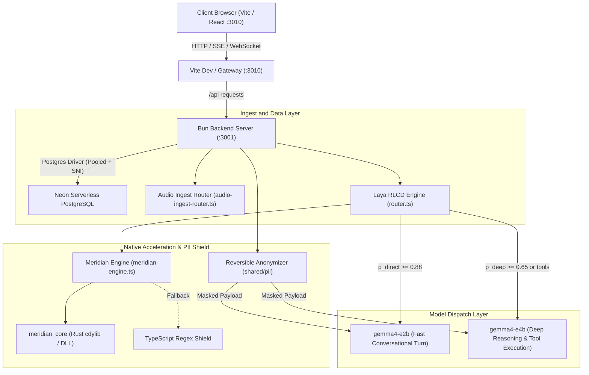

# Meridian product specification

Workspace: Meridian  
Repository root: `C:\Users\yashv\Desktop\openflow`  
Default local access: `http://localhost:3010`

---

## 1. Product definition

Meridian is a self-hosted AI workspace and assistant platform that runs on private infrastructure. It executes browser actions, orchestrates multi-agent tasks, and streams multimodal voice sessions without sending unmasked data or telemetry to external third parties.

### Core technical constraints
- Zero telemetry egress: Client traffic stays inside private network boundaries or defined upstream endpoints.
- Deterministic PII neutralization: Sensitive tokens are scrubbed prior to model inference and reinjected on egress.
- Direct multimodal audio: Voice input streams without text transcript hops, reducing turnaround latency.
- Isolated multi-agent workspaces: Coworker agents run with distinct tools, memory isolation, and audit-logged capabilities.

---

## 2. System architecture



---

## 3. Storage and data model

Meridian connects to Neon PostgreSQL using connection pooling with SNI routing.

- Database client: `postgres.js` with explicit pooler endpoint parameter (`options=endpoint%3D<endpoint-id>`).
- Migration harness: `bun --env-file=.env server/scripts/migrate.ts`.
- Schema coverage:
  - Users, sessions, and authentication tokens.
  - Organization and tenant configurations (`fintech`, enterprise policies).
  - Conversation threads, messages, and streaming event checkpoints.
  - Active background jobs, agent execution steps, and tool audit logs.

---

## 4. Reversible PII neutralization

All user text and voice prompts pass through deterministic masking before leaving private process memory.

Source: `shared/pii/anonymizer.ts`

### Target entities
1. Email addresses: Matches RFC-5322 patterns; tokenized as `<EMAIL_N>`.
2. Credit card numbers: Matches Visa, Mastercard, Amex, Discover formats; tokenized as `<CREDIT_CARD_N>`.
3. Social Security numbers: Matches standard 9-digit formats; tokenized as `<SSN_N>`.
4. Phone numbers: Matches international and North American numbering plans; tokenized as `<PHONE_NUMBER_N>`.
5. IP addresses: Matches IPv4 and IPv6 string addresses; tokenized as `<IP_ADDRESS_N>`.
6. API secrets: Matches `sk-`, `ghp_`, and `AIza` keys; tokenized as `<API_KEY_N>`.

### Inversion cycle
1. Ingest: `anonymizePii(rawText, options)` extracts matched values, generates random or indexed substitute tokens, and returns `PiiTokenMap`.
2. Reasoning: Remote or local LLM executes against anonymized prompt content.
3. Egress: `deanonymizePii(modelOutput, tokenMap)` replaces tokens with stored sensitive strings before returning output to client.

---

## 5. Voice pipeline and dual-model routing

### 5.1 Direct audio ingest
Source: `server/src/voice/audio-ingest-router.ts`

- Eliminates intermediate speech-to-text transcription stages.
- Emits real-time SSE stream events:
  - `thought_chunk`: Model reasoning steps delivered to thought containers.
  - `output_chunk`: User-facing conversational tokens.
  - `tool_call_chunk`: Machine-readable tool payloads.
  - `done`: Terminal event with performance metadata.

### 5.2 Laya RLCD edge classifier
Source: `server/src/voice/router.ts` and `server/src/voice/native/`

Routes turns between fast edge weights and deep reasoning weights based on query complexity:
- Base prior: `0.90` direct probability.
- Length penalty: `-0.15` for turns exceeding 30 words.
- Tool indicators: `-0.35` per detected execution verb (`browse`, `run`, `database`, `fetch`, `execute`).
- Routing decision gates:
  - Fast turn (`gemma4-e2b`): `p_direct >= 0.88`.
  - Deep turn (`gemma4-e4b`): `p_deep >= 0.65` or explicit tool indicator match.

---

## 6. Preloaded coworker bots and capabilities

Meridian supplies 10 pre-configured coworker personas tailored for technical and financial environments (`examples/fintech/agents/`):

1. `lead-architect`: System design, RFC reviews, and structural database planning.
2. `sec-auditor`: Zero-trust security audits, CVE tracking, and secret exposure scans.
3. `data-engineer`: Neon PostgreSQL query planning, indexing, and migration pipelines.
4. `compliance-officer`: PII leak verification, SOC2 checklists, and audit trail validation.
5. `devops-sre`: Infrastructure monitoring, port hygiene, and container reliability.
6. `frontend-specialist`: React, Tailwind, and TanStack Router UI optimization.
7. `qa-automator`: Playwright test suites, regression scans, and end-to-end verification.
8. `finance-analyst`: Financial statement modeling and quantitative reporting.
9. `triage-bot`: GitHub issue routing, automated labeling, and pull request reviews.
10. `onboarding-guide`: Workspace configuration, environment setup, and tool onboarding.

### Integrated tool skills
- GitHub repository management: PR creation, issue triage, branch inspection.
- Slack team synchronization: Thread mirroring, notifications, and operational alerts.
- Database auditing: Schema drift checks, index performance, and migration status.
- Web automation: Playwright-driven headless browser execution.

---

## 7. Verification and test commands

All modules require passing test suites prior to deployment:

```bash
# Validate PII masking and token inversion
bun test shared/pii/anonymizer.test.ts

# Validate streaming audio reasoning parser
bun test shared/pii/audio-reasoning-parser.test.ts

# Validate Laya engine voice routing and WebRTC headers
bun test server/tests/meridian-voice.test.ts

# Validate tenant configuration integrity
bun test tests/fintech-package.test.ts

# Apply database migrations to Neon
bun --env-file=.env server/scripts/migrate.ts
```
