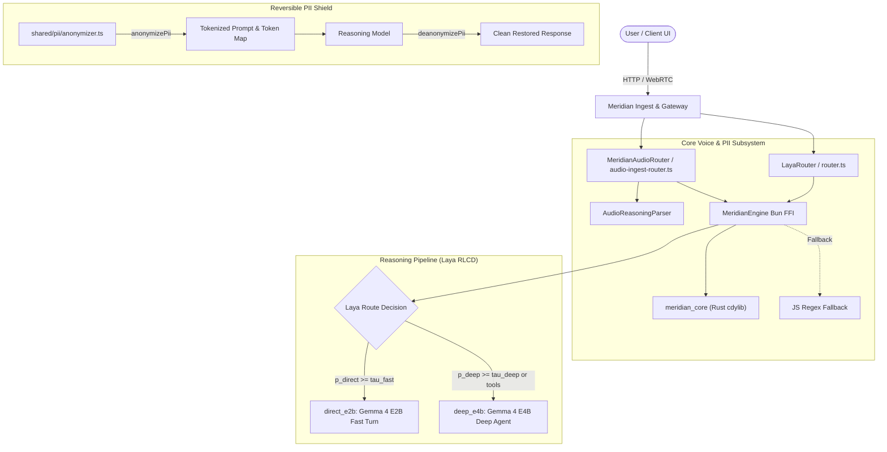

# Meridian: source of truth

> **Status**: Reference document  
> **Workspace**: Meridian  
> **Repository root**: `C:\Users\yashv\Desktop\openflow`

---

## 1. Overview and scope

Meridian is a self-hosted local workspace and assistant environment designed to run on private infrastructure with zero external telemetry.

### Core mechanisms
- **Reversible entity masking.** Replaces sensitive strings (emails, credit card numbers, SSNs, phone numbers, API keys, IP addresses) with token identifiers before external model calls, then restores the original values on response egress.
- **Tiered edge routing.** Routes low-latency turns to `gemma4-e2b-it` and delegates tool use or complex steps to `gemma4-e4b-it`.
- **Sandboxed execution.** Isolates agent subprocesses with DOM and network audit logs.
- **Tenant configurations.** Supports per-tenant parameters via configuration files like `examples/fintech/brand.yaml`.

Default access URL: `http://localhost:3010`

---

## 2. Architecture and components

---

## 3. Native engine (`meridian_core`)

Source: `server/src/voice/native/`
- **Language**: Rust (`src/lib.rs`, `Cargo.toml`)
- **FFI specification**: `server/src/voice/native/meridian_core.h`
- **Compiled artifacts**:
  - Windows: `meridian_core.dll` (`libmeridian_core.dll.a`, `libmeridian_core.rlib`)
  - Linux: `libmeridian_core.so`
  - macOS: `libmeridian_core.dylib`

### Exported C ABI functions
1. `int meridian_engine_init(size_t worker_threads)`
   - Spawns worker threads (`pthread` on Unix, `CreateThread` on Windows).
   - Sets atomic running state to true.
2. `void meridian_engine_shutdown(void)`
   - Signals thread exit, joins threads with `WaitForSingleObject` or `pthread_join`, and deallocates the thread pool.
3. `PiiGateResult* meridian_sanitize_pii(const char* input_text, PiiMaskMode mode)`
   - Strips email addresses, phone numbers, SSNs, credit card numbers, and API keys with regex matches.
   - Measures duration in nanoseconds (`processing_time_ns`).
4. `void meridian_free_pii_result(PiiGateResult* result)`
   - Frees allocated `PiiGateResult` memory and internal strings.
5. `LayaDecisionResult* meridian_eval_laya_routing(const char* sanitized_transcript, double tau_fast, double tau_deep, int tool_indicators_count, double ambiguity_level)`
   - Calculates query routing scores:
     - Baseline score (`direct_prior`): `0.90`
     - Word count deduction (> 30 words): `-0.15`
     - Tool indicator deduction: `-0.35 * min(indicators, 2)`
     - Ambiguity deduction (> 0.4): `-ambiguity * 0.4`
     - Action keywords (`check`, `run`, `browse`, `schedule`, `execute`, `fetch`, `calculate`, `search`, `lookup`, `database`, `api`, `order`, `book`): `-0.15` per occurrence.
   - Computes `p_direct`, `p_deep = 1.0 - p_direct`, and Brier score `(p_direct - y)^2`.
   - Routing rules:
     - Selects `direct_e2b` when `p_direct >= tau_fast` (default `0.88`).
     - Selects `deep_e4b` when `p_deep >= tau_deep` (default `0.65`), `tool_indicators > 0`, or `ambiguity_level >= 0.5`.
6. `void meridian_free_laya_result(LayaDecisionResult* result)`
   - Frees the allocated `LayaDecisionResult` struct.

---

## 4. Bun FFI bridge (`server/src/voice/meridian-engine.ts`)

The `MeridianEngine` wrapper class:
- Loads the `meridian_core` binary via `bun:ffi` `dlopen`.
- Spawns four worker threads on initialization.
- Methods:
  - `MeridianEngine.isNative()`: Returns whether the native binary loaded.
  - `MeridianEngine.filterPii(text, mode)`: Strips and replaces sensitive strings.
  - `MeridianEngine.scoreLayaRouting(transcript, options)`: Evaluates routing probabilities.
  - `MeridianEngine.shutdown()`: Frees native resources on process exit.
- Fallback: Uses TypeScript regex patterns if the native binary is missing.

---

## 5. Voice and reasoning subsystem

### 5.1 Direct audio ingest router (`server/src/voice/audio-ingest-router.ts`)
- **Class**: `MeridianAudioRouter`
- **Behavior**: Streams raw audio chunks directly into multimodal context without an intermediate speech-to-text step.
- **Session ID format**: `meridian-audio-<timestamp>-<random_hex>`
- **Stream events (`MeridianStreamEvent`)**:
  - `thought_chunk`: Emits intermediate tokens to the reasoning UI.
  - `output_chunk`: Sends final response text to the user.
  - `tool_call_chunk`: Delivers tool calls triggered by the model.
  - `done`: Emits on completion or stream cancellation.

### 5.2 Realtime WebRTC provider (`server/src/voice/provider.ts`)
- Manages realtime voice sessions over WebRTC.
- Sends header: `x-meridian-engine: laya-rlcd`.
- Payload schema:
  - `edge_model`: `gemma4-e2b`
  - `deep_model`: `gemma4-e4b`
  - WebRTC transport negotiation with SDP handshake.

---

## 6. PII tokenization layer (`shared/pii`)

Deterministic entity replacement and restoration:
- **Entity types**:
  - `EMAIL`
  - `CREDIT_CARD`
  - `SSN`
  - `PHONE_NUMBER`
  - `IP_ADDRESS`
  - `API_KEY` (`sk-`, `ghp_`, `AIza`)
- **Functions**:
  - `anonymizePii(text, options)`: Replaces matches with `<PII_TYPE_N>` tokens and returns a `PiiTokenMap`.
  - `deanonymizePii(text, tokenMap)`: Inverts tokens back to original values.
  - `AudioReasoningParser`: Splits streaming tokens between `<thought>...</thought>` blocks and user text while maintaining token mappings.

---

## 7. Environment configuration

| Variable | Purpose | Default |
| :--- | :--- | :--- |
| `VOICE_PROVIDER` | Realtime voice driver | `openflow-realtime` / `meridian-realtime` |
| `VOICE_MODEL` | Default voice edge model | `gemma4-e2b` |
| `VOICE_LAYA_ENDPOINT` | External classification endpoint | None (uses native library) |
| `VOICE_TAU_FAST` | Threshold for direct conversational routing | `0.88` |
| `VOICE_TAU_DEEP` | Threshold for deep reasoning and tool use | `0.65` |

---

## 8. Test suite

Bun test commands cover Meridian modules:
- Voice test: `bun test server/tests/meridian-voice.test.ts`
  - PII sanitization and redacting.
  - LayaRouter direct route dispatch (`direct_e2b`).
  - LayaRouter deep route dispatch (`deep_e4b`).
  - WebRTC headers (`x-meridian-engine`) and payload shape.
- Parser test: `bun test shared/pii/audio-reasoning-parser.test.ts`
- Multi-tenant test: `bun test tests/fintech-package.test.ts`
